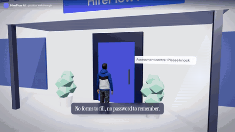
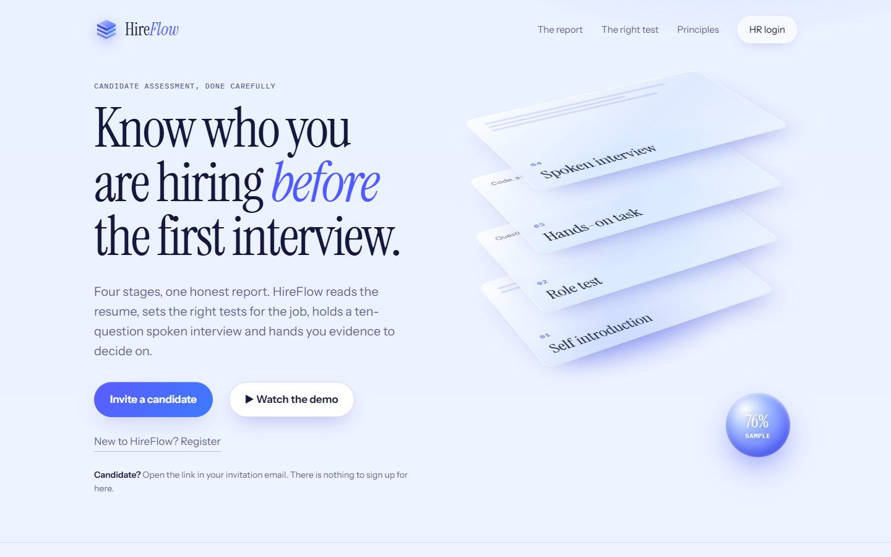
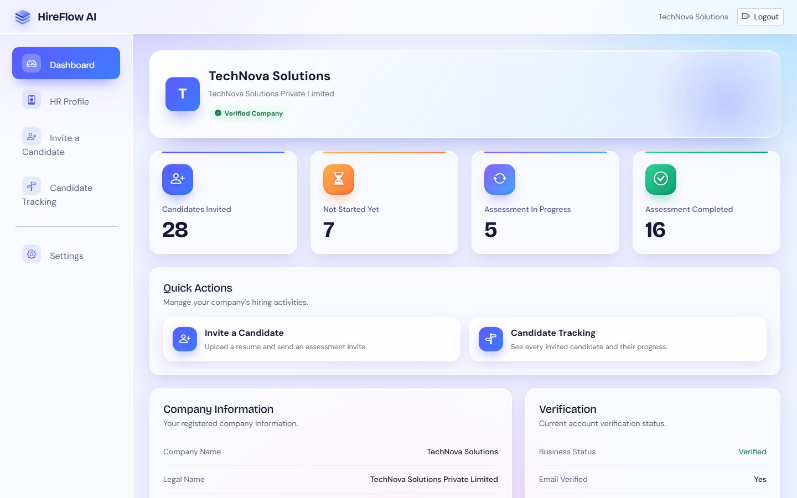
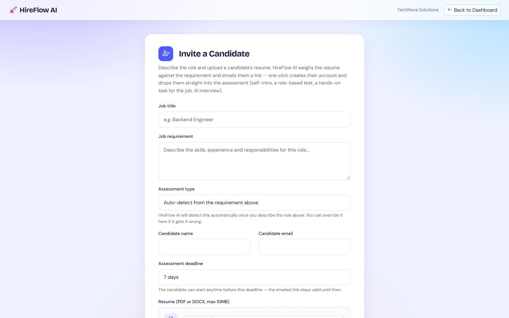
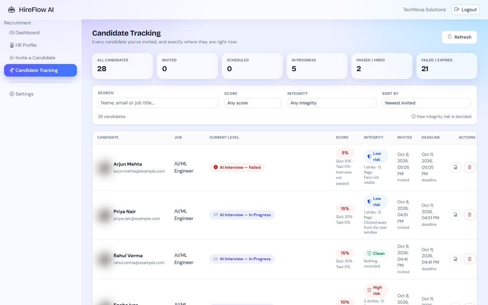
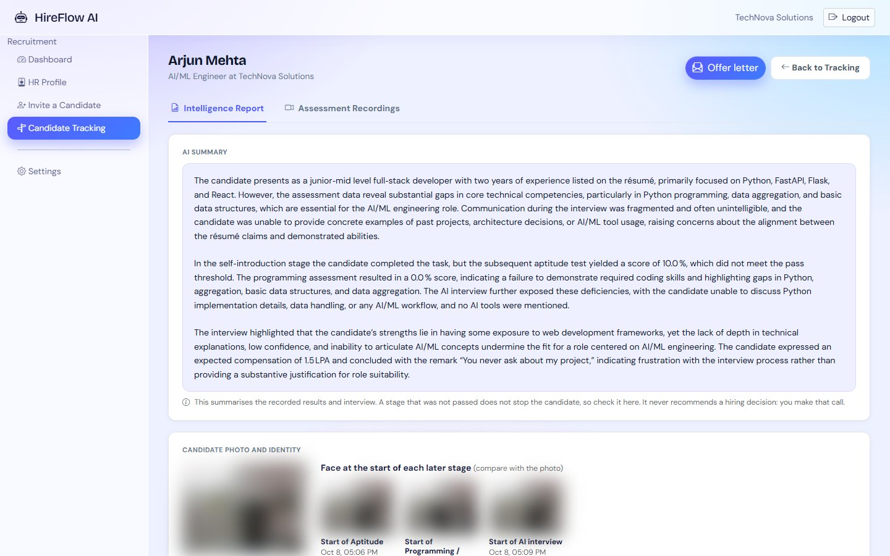
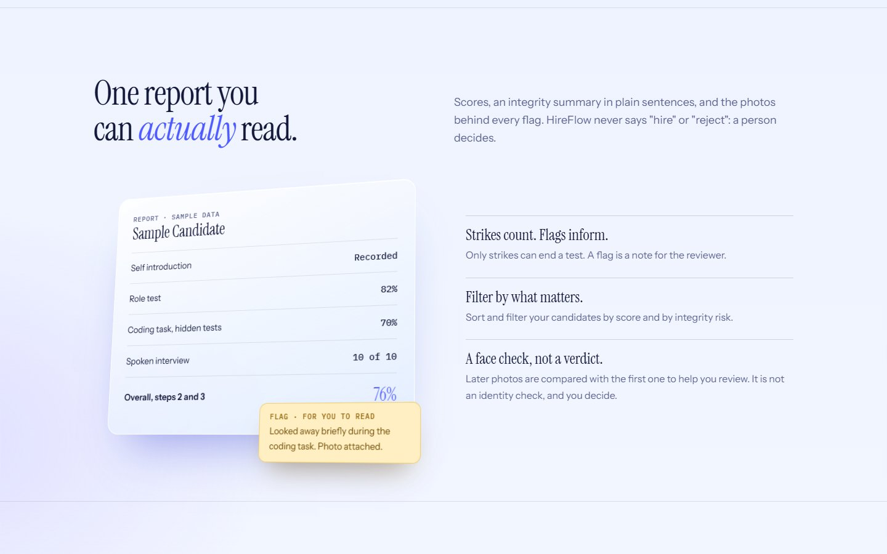
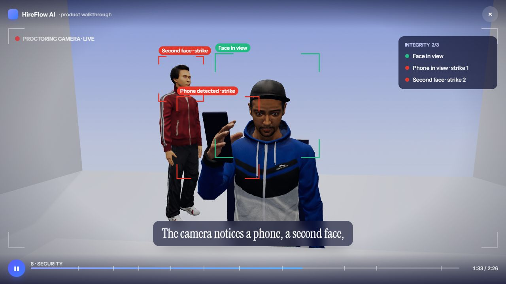
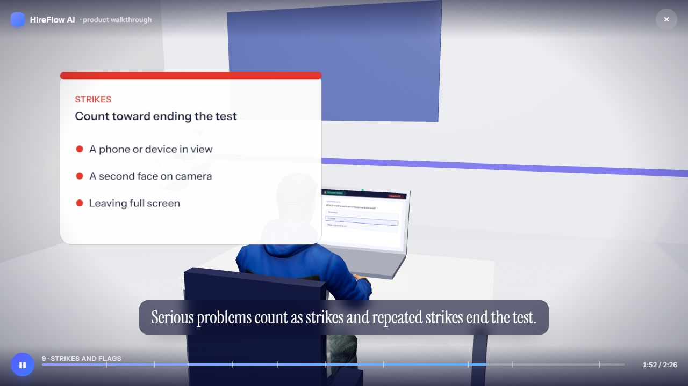
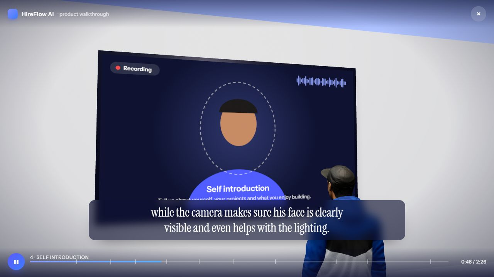

# HireFlow AI

**AI-assisted candidate assessment for HR teams.** HR uploads a resume and describes the role. HireFlow AI weighs the resume against the job, emails the
candidate a link, and runs a proctored assessment: a self introduction, a role-based knowledge test, a hands-on task chosen for the job, and a live
spoken AI interview. HR then reads **one report per candidate** with scores, an AI summary, an integrity summary and a face check.

> Formerly named JobPilot AI. Some internal names still say `jobpilot`.

## Demo

[](docs/demo/hireflow-walkthrough.mp4)

**[Watch the full 2.5-minute walkthrough (MP4, with narration)](docs/demo/hireflow-walkthrough.mp4)**: a student candidate goes from the front door to the offer
letter, through the HR desk, the phone invite, the four assessment rooms, the live AI interview, the proctoring view, and the HR report. The same film plays
in the browser from the home page ("Watch the demo").

## Screenshots

| Home page | HR dashboard |
|---|---|
|  |  |
| **Invite a candidate** | **Candidate tracking** |
|  |  |
| **One report per candidate** | **The report on the home page** |
|  |  |
| **AI interviewer (walkthrough)** | **Proctoring view (walkthrough)** |
|  |  |
| **Strikes and flags (walkthrough)** | **Self introduction room (walkthrough)** |
|  |  |

Candidate names, emails and photos in the screenshots are samples or blurred.

## What it does

```
HR uploads resume + job title/requirement
        -> AI analyses the resume against the role and picks the assessments
        -> candidate gets an emailed magic link (no password) and can schedule a time
-> opening the link builds the candidate's account from the resume: active resume, analysis, name, phone, links and a filled profile
        -> self introduction  ->  role test  ->  hands-on task  ->  AI voice interview
        -> HR report: scores, AI summary, integrity breakdown, face check, offer letter
```

### Assessments are chosen per job

A catalogue of **96 IT roles in 16 domains** (plus an AI planner for unknown titles) decides what each candidate sees:

| Role family | Hands-on task |
|---|---|
| Developers (Python, Java, JS, C#, ...) | Real coding, run against hidden tests in a Docker sandbox |
| DevOps, SRE, SOC, network, cloud, security | **Technical lab**: a log, config, network plan or policy with 5 exact, code-checked questions |
| SAP, Salesforce, Workday, RPA, GIS, embedded | Platform knowledge question bank |
| Finance, MIS, HR, operations | **Data task**: a generated table with answers computed by code |
| QA, support, marketing, product, writing | **Written task**, marked by AI against a rubric |
| UI/UX and web design | **Drag-and-drop page builder**, marked by code metrics plus a vision model |
| Sales, support calls | **Voice role-play** on the realtime engine |

### The AI interview

A spoken, adaptive interview over LiveKit with Gemini Live, exactly ten questions: six about the role (from the resume and the job requirements), two about
AI (how the candidate would use it on a real task of the job, and where it falls short), a closing job-fit question, and the expected salary last, then a full
closing speech. The server holds the script (it arms the model with its next step before the candidate
answers), counts the position itself, and treats "I can't hear you", questions about the job, pauses and attempts to manipulate the interviewer as
non-answers. Attempts to manipulate it are flagged for HR.

### Integrity and proctoring

Camera face checks (MediaPipe, in the browser), phone detection (YOLOv8n via ONNX Runtime Web), fullscreen and tab locking, whole-screen sharing, blocked
copy/paste and developer-tool shortcuts, automated-typing detection, a lighting coach, and periodic photos. Signals are split into **strikes** (count
toward ending the test) and **flags** (for the recruiter to read). HR sees a plain-language breakdown and a risk level (clean / low / medium / high),
and can filter the candidate list by score and integrity. A **face check** compares later photos with the reference photo; it is a recruiter aid, not an
identity verification. The candidate-facing rules give no timings or limits.

### HR side

Email-verified HR accounts (6-digit code), an invite form with an AI plan preview, a candidate tracking dashboard with score and integrity filters,
an intelligent report per candidate, and an offer-letter composer with attachments.

## Tech stack

| Layer | Technology |
|---|---|
| Backend | Python, FastAPI, SQLAlchemy, SQLite |
| Frontend | Vanilla HTML/CSS/JS, Bootstrap 5 (bundled in `frontend/vendor`) |
| Live interview | Google Gemini Live (voice), LiveKit, Groq `openai/gpt-oss-120b` (question brain and evaluation) |
| Marking | Groq (written tasks, planner), Gemini vision models (design page, face check) |
| Proctoring | MediaPipe Face Landmarker, ONNX Runtime Web, browser APIs |
| Code execution | Docker, one throw-away container per run (no network, memory/CPU/process limits) |
| Email | SMTP (Gmail App Password) or the Gmail API |

## Run it locally

Requirements: Python 3.11+, Docker Desktop (only for the coding test), a Gemini API key and a Groq API key.

```bash
python -m venv venv
venv\Scripts\activate            # Windows   (macOS/Linux: source venv/bin/activate)
pip install -r requirements.txt

copy .env.example .env           # then fill in the keys (GEMINI_API_KEY, Groq, LiveKit, SMTP ...)

# backend (http://127.0.0.1:8000)
python -m uvicorn backend.app.main:app --reload

# frontend (http://127.0.0.1:5600), in another terminal
python -m http.server 5600 --directory frontend
```

Then open `http://127.0.0.1:5600` (port 5500 is reserved by Windows on some machines). `start_jobpilot.bat` starts both on Windows. Demo HR accounts can be created with `python -m backend.app.services.seed_demo_data`;
read `DEMO_RUNBOOK.md` for a step-by-step demo.

**Set `ASSESSMENT_MAX_VIOLATIONS=3` for real use.** Raise it only for demos.

## Tests

```bash
python -m pytest tests -q          # about 1,300 backend tests
cd tests/frontend && for f in test_*.js; do node "$f"; done      # frontend logic tests
```

Tests that run candidate code need Docker, and a few check `.env` provider defaults, so they fail on a machine where those are not set up.

## Project layout

```
backend/app/api/routes/        HTTP routes (companies, invites, assessments, HR review, interview, ...)
backend/app/services/          assessment planner, role catalogue, practical tasks, interview engine, integrity, face match, email
backend/app/models/            SQLAlchemy models
frontend/                      pages (company-*.html for HR, assessment/test/interview pages for candidates) and js/
frontend/vendor/               bundled third-party files (see vendor/README.md for versions and licences)
tests/                         backend tests and tests/frontend (node)
docker/                        sandbox images for the coding test
```

## Honest limits

- Free-tier AI limits (Groq, Gemini) slow marking on busy days; the planner then falls back to rules.
- SQLite and `uvicorn --reload` are fine for a demo, not for production traffic.
- The platform question banks (SAP, Salesforce, ...) are small.
- Face check and proctoring signals are aids for a human reviewer, not verdicts.

## Licences

Third-party files and their licences are listed in `frontend/vendor/README.md`. **The bundled phone-detection model (YOLOv8n) is AGPL-3.0**; check it before
any commercial use. The model file itself (`frontend/vendor/models/yolov8n.onnx`) is **not** in this repository: download it as described in
`frontend/vendor/README.md` and place it at that path, otherwise phone detection will not run. No licence file has been added yet, so all rights
to this project's own code stay with the author.
